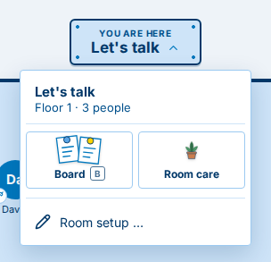
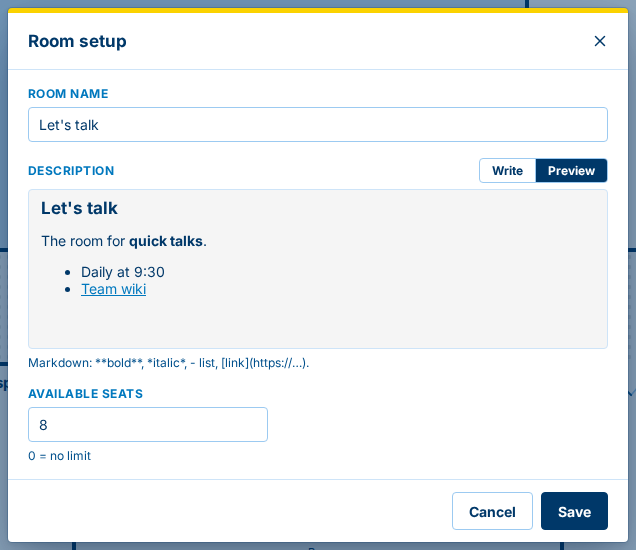
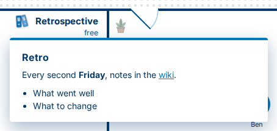
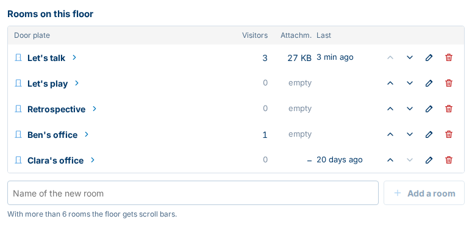
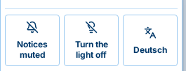

[All versions](README.md) · [0.39.0 →](0.39.0.md)

# What's new in Ruumble 0.38.0

*6 November 2026*

Changes marked  reach you once the Ruumble server you use is updated.

## New

### The room menu 

Click the room sign at the top ("You are here") to open the menu of the room you are in. From there you can show the
**board** and open the **room care**, and, if you're allowed to change the room, open **Room setup**. On the corridor,
the same menu covers the whole floor.

### Set up a room 

In Ruumble Client, if you're allowed to change a room, **Room setup** in the room menu lets you rename it, write its
description and set how many seats it has. You write the description in Markdown (headings, lists, **bold** text and
links), and the preview shows how it will look.

### Descriptions with headings, lists and links 

The binders in a room show its description. Descriptions written in Room setup now appear with their headings, lists,
bold text and links.

### Manage the rooms on a floor 

The **floor care** (the plant on the corridor, or the tile in the corridor's menu) now lists the rooms on the floor and
how many people are in each. In Ruumble Client, if you're allowed to change them, you can **add** a room, **rename** it,
move it **up or down** in the order (also with Alt and the arrow keys) and **delete** it. When you delete a room, you
decide whether to keep its board for later or delete it with all its data, and you can save the board as a ZIP file
first.

### A light switch 

The dark mode switch in the user menu is now a light switch, just like in a real building: **Turn the light off** for
the dark look, **Turn the light on** to switch back.

## Better 

- The building now stands on its own site: a soft blue-grey around the floor plan and a gentle shadow make it stand out.
- Windows such as the keyboard shortcuts and the building overview have a frame and a yellow band on top, so they stand
  out from the page behind them.
- A channel inside a room no longer locks the whole floor. The floor shows its rooms as usual; the extra channel is
  simply left out.
- Comma and full stop no longer switch the tabs in Ruumble in a box. The arrow keys in the tab row still do.

## Fixed

- On a floor with many rooms, the plant and the binders on the corridor now stay in view while you scroll. 
- The building overview no longer slides to the side when its search field gets the focus. 
- The building overview now shows the right key for a quiet word: **T**. 
- In Ruumble Client, a right click on a room no longer offers "Add". A channel added there used to lock the whole floor.

[All versions](README.md) · [0.39.0 →](0.39.0.md)
