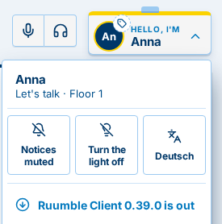

[← 0.38.0](0.38.0.md) · [All versions](README.md)

# What's new in Ruumble 0.39.0

*6 November 2026*

Changes marked  reach you once the Ruumble server you use is updated.

## New

### Ruumble Client tells you when a new version is out 

When a newer Ruumble Client is available, a small red dot appears on your name badge, and the user menu offers the new
version at the top. One click opens the download page.

### Update the AppImage with one click

From this version on, the AppImage knows where its updates come from. Tools such as
[Gear Lever](https://flathub.org/apps/it.mijorus.gearlever) or
[AppImageUpdate](https://github.com/AppImageCommunity/AppImageUpdate) update it in place and only download what changed.

[← 0.38.0](0.38.0.md) · [All versions](README.md)
