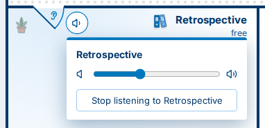

[← 0.39.0](0.39.0.md) · [All versions](README.md)

# What's new in Ruumble 0.40.0

*7 November 2026*

Changes marked  reach you once the Ruumble server you use is updated.

## New

### Push to talk, right in the top bar 

In Ruumble Client, a small tab next to the microphone lets you choose how you transmit: voice activation, push to talk or always on. With push to talk, the microphone becomes your talk button: hold it to talk, let go to go quiet, double-click to keep it open. While you talk, the button turns blue and the line under the top bar lights up, so you always know when others can hear you.

The first time you choose push to talk, Ruumble asks for a talk key and suggests Right Ctrl. On X11 desktops the key works everywhere, even while another window is in front. On Wayland it works while Ruumble Client is in front. You need the new Ruumble Client for this.

### Listen in on another room 

In Ruumble Client, click the door of another room on your floor to listen in without going in. The door opens a little further, the room lights up softly, and you hear it, quietly at first. The small speaker next to the door sets the volume. Click the door again to stop.

While you listen, an ear tab hangs next to "You are here". It lists the rooms you are listening to and lets you stop them all. Your own room comes first: when someone talks there, the other rooms get quieter. You can turn that off in the list.

You can only listen to rooms on your own floor. Changing the floor or going into the room ends it. You need the new Ruumble Client for this.

## Better

- Ruumble Client shows its own icons in the system tray: one clear sign for each state, such as talking, muted or deafened. The window list shows the Ruumble icon too.

## Fixed 

- Room descriptions are always shown as formatted text. Descriptions written in Mumble's own editor now show as plain text with their links, and descriptions written in Ruumble also work on servers that do not allow HTML.
- In Ruumble Client, opening the description of a corridor no longer breaks the floor plan.
- In Ruumble Client, the directory in the building overview fits again: it is no longer cut off on the right, and you can read the full room names.

[← 0.39.0](0.39.0.md) · [All versions](README.md)
