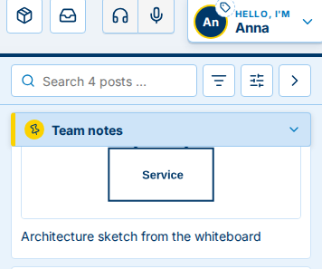
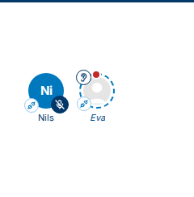

[← 0.41.0](0.41.0.md) · [All versions](README.md)

# What's new in Ruumble 0.41.1

*9 November 2026*

Changes marked  reach you once the Ruumble server you use is updated.

## Better

### The pinned post stands out

The post kept on top of the board is easy to spot now: it sits on a tinted note with a yellow edge and a yellow pin, above all other posts.

A new Ruumble Client now shows up within an hour on your name badge and in the user menu. 

Someone listening in with their own picture now shows it grey and faint, so you can tell them apart from the people in the room. 

[← 0.41.0](0.41.0.md) · [All versions](README.md)
