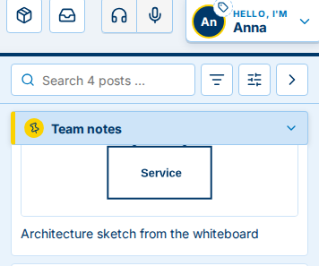

<!--
  The "What's new" page of the next version, for users (#17). tools/release.sh turns it into <version>.md with the
  title, the date and the links to the other versions, and starts this file again.
  Plain, natural English, as a native product writer would put it: short sentences, no jargon, what the user can do or
  see now. Leave out polish users would not notice. Sections: New, Better, Fixed (leave out an empty one).
  Server and Ruumble Client are not told apart; a change that reaches the user only once the server is updated (the
  web UI and the service) gets the orange badge : after the ### heading of a larger change, after
  a ## section heading when every line in it needs the server, else at the end of the line. A short ### heading per larger change, one line per
  small one. Small screenshots where they help: web/scripts/whats-new-shots.mjs writes them to images/next/.
-->

Changes marked  reach you once the Ruumble server you use is updated.

## Better

### The pinned post stands out

The post kept on top of the board is easy to spot now: it sits on a tinted note with a yellow edge and a yellow pin, above all other posts.

A new Ruumble Client now shows up within an hour on your name badge and in the user menu. 
