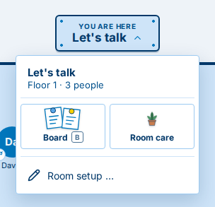
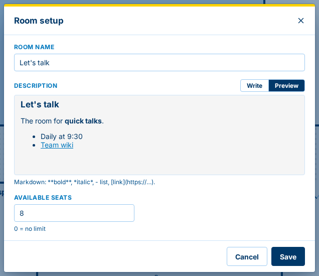
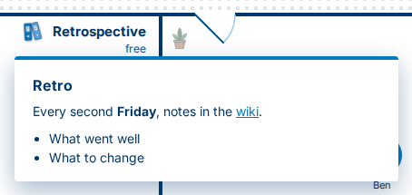
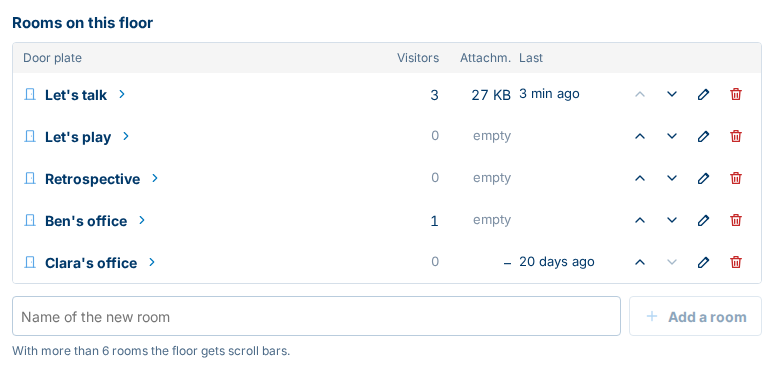
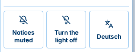

<!--
  The "What's new" page of the next version, for users (#17). tools/release.sh turns it into <version>.md with the
  title, the date and the links to the other versions, and starts this file again.
  English, simple words, what the user can do or see now. Sections: New, Better, Fixed (leave out an empty one).
  Server and Ruumble Client are not told apart; a change that reaches the user only once the server is updated (the
  web UI and the service) ends with the label `server update`. A short ### heading per larger change, one line per
  small one. Small screenshots where they help: web/scripts/whats-new-shots.mjs writes them to images/next/.
-->

Changes marked `server update` reach you once the Ruumble server you use is updated.

## New

### The room menu `server update`

Click the room sign at the top ("You are here") to open the menu of the room you are in: show the **board**, look after
the **room care**, and, if you may change the room, open **Room setup**. On the corridor the same menu is there for the
whole floor.

### Set up a room `server update`

**Room setup** in the room menu lets you rename the room, write its description and set how many seats it has. The
description is written in Markdown: headings, lists, **bold** text and links. The preview shows how it will look.
(Inside Ruumble Client, if you may change the room.)

### Descriptions with headings, lists and links `server update`

The binders in a room show its description. A description written in Room setup now appears with its headings, lists,
bold text and links.

### Look after the rooms of a floor `server update`

The **floor care** (the plant on the corridor, or the tile in the corridor's menu) now lists the rooms of the floor with
how many people are in each. Inside Ruumble Client, if you may change them, you can **add** a room, **rename** it, move
it **forward or back** (also with Alt and the arrow keys) and **delete** it. When you delete a room you choose: keep its
board for later, or delete it with all its data; you can save the board as a ZIP file first.

### A light switch `server update`

The dark mode switch in the user menu is now a light switch, like in a real building: **Turn the light off** for the
dark look, **Turn the light on** to go back.

## Better

- The building stands on its own site: a soft blue-grey around the floor plan and a gentle shadow make it stand out. `server update`
- Windows such as the keyboard shortcuts or the building overview have a frame and a yellow band on top, so they stand
  out from the page. `server update`
- A channel below a room no longer closes the whole floor. The floor shows its rooms as usual; the extra channel is
  simply not shown. `server update`
- The tiles in the menus have a little more room between picture and text, and the board tile shows its key **B**. `server update`
- Comma and full stop no longer switch the tabs of Ruumble in a box (the arrow keys in the tab row still do). `server update`

## Fixed

- The building overview no longer slides to the side when its search field gets the focus. `server update`
- The building overview names the right key for a quiet word: **T**. `server update`
- In Ruumble Client, a right click on a room no longer offers "Add": a channel added there closed the whole floor.
